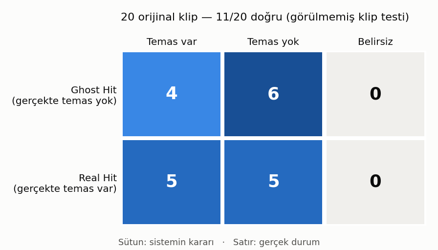
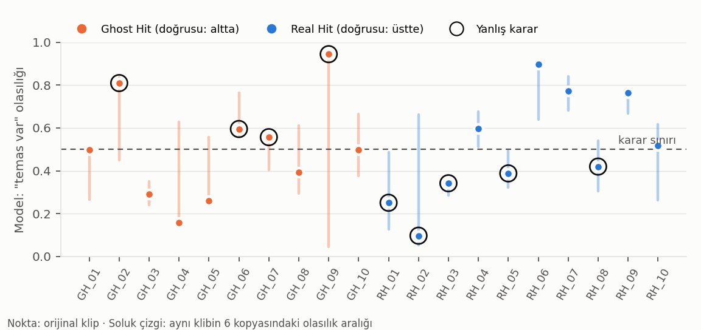
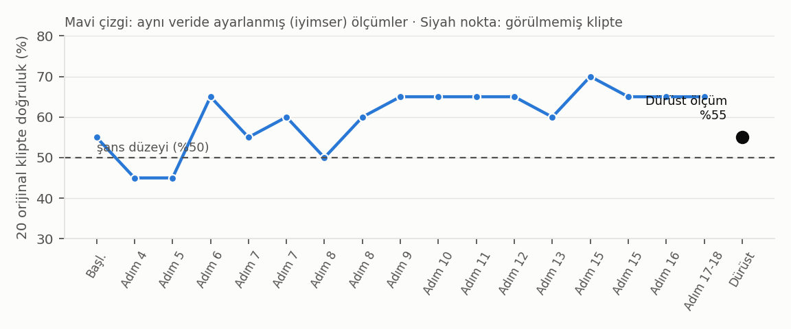

# Sonuç Raporu

*Üretildi: 2026-11-25 13:30 · `python sonuc_raporu.py` · ölçümler: `output\reports\ozellikler.csv`*

Bu rapor, sistemin **hiç görmediği kliplerdeki** başarısını özetler. Her klip, tüm çoğaltılmış kopyalarıyla birlikte bir kez dışarıda tutulmuş; karar modeli kalan 19 klip ile eğitilip dışarıdaki klipte test edilmiştir (birini dışarıda bırakarak doğrulama). Eşikler test verisine göre ayarlanmamıştır.

---

## 1. Özet

| | Sonuç |
|---|---|
| **Doğruluk (20 orijinal klip)** | **11/20 (%55)** |
| %95 güven aralığı | %34 – %74 |
| Şans düzeyinde bir sistemin bu kadar veya daha iyi sonuç alma olasılığı | %41 |
| Doğruluk (120 video, çoğaltılmışlar dahil) | 63/120 (%52) |
| Ghost Hit yakalama (10 klipten) | 6/10 |
| Real Hit'i doğru onaylama (10 klipten) | 5/10 |

**Yorum:** 11/20 sonucu şans düzeyinden istatistiksel olarak ayırt edilemiyor (yazı-tura atan bir sistem de %41 olasılıkla bu sonucu alır). Mevcut ölçümler 20 klipte Real Hit ile Ghost Hit'i güvenilir biçimde ayıramıyor. Sistem bu yüzden her kararı kalibre edilmiş, çoğunlukla **düşük** bir güvenle verir ve nihai kararı hakeme bırakır.

---

## 2. Karmaşıklık matrisi

Veri setindeki tüm klipler sensörün puan verdiği anlardır. Bu yüzden "temas yok" kararı **Ghost Hit (puan hatalı)**, "temas var" kararı **puan geçerli** anlamına gelir.

| Gerçek durum ↓ / Sistem kararı → | Temas var | Temas yok | Belirsiz |
|---|---|---|---|
| **Ghost Hit** (temas yok) | 4 | 6 | 0 |
| **Real Hit** (temas var) | 5 | 5 | 0 |

- **Yakalanan Ghost Hit:** 6 — sistem hatalı puanı doğru tespit etti.
- **Kaçırılan Ghost Hit:** 4 — hatalı puan geçerli sayıldı.
- **Haksız iptal önerisi:** 5 — gerçek bir vuruş için "puan hatalı" denildi. Sahada en maliyetli hata budur; bu yüzden sistemin kararı tek başına puan iptali için kullanılmamalıdır.
- **Doğru onay:** 5 — gerçek vuruşun puanı onaylandı.

120 videonun tamamında (her klibin 5 çoğaltılmış kopyası dahil):

| Gerçek durum ↓ / Sistem kararı → | Temas var | Temas yok | Belirsiz |
|---|---|---|---|
| **Ghost Hit** | 25 | 33 | 2 |
| **Real Hit** | 30 | 30 | 0 |

---

## 3. Klip klip sonuçlar

| Klip | Gerçek | Karar | Olasılık | Doğru mu | 6 kopyadan doğru | Baş görünürlüğü | Baş dönüşü | Burun savrulması | Ayak-baş mesafesi (baş yarıçapı) |
|---|---|---|---|---|---|---|---|---|---|
| GH_01 | Temas yok | Temas yok | %49.7 |✅ | 6/6 | %100 | 1.08 | 137 | 12.2 |
| GH_02 | Temas yok | Temas var | %80.9 |❌ | 1/6 | %100 | 0.87 | 437 | 8.1 |
| GH_03 | Temas yok | Temas yok | %29.2 |✅ | 6/6 | %85 | 0.39 | 134 | 9.3 |
| GH_04 | Temas yok | Temas yok | %15.7 |✅ | 5/6 | %85 | 0.34 | 26 | 16.5 |
| GH_05 | Temas yok | Temas yok | %26.1 |✅ | 4/6 | %62 | 0.60 | 102 | 20.0 |
| GH_06 | Temas yok | Temas var | %59.5 |❌ | 0/6 | %95 | 1.10 | 208 | 10.6 |
| GH_07 | Temas yok | Temas var | %55.7 |❌ | 4/6 | %95 | 0.96 | 224 | 9.0 |
| GH_08 | Temas yok | Temas yok | %39.3 |✅ | 4/6 | %82 | 0.47 | 200 | 8.2 |
| GH_09 | Temas yok | Temas var | %94.4 |❌ | 0/6 | %100 | 1.94 | 310 | 14.3 |
| GH_10 | Temas yok | Temas yok | %49.7 |✅ | 3/6 | %97 | 1.01 | 99 | 11.5 |
| RH_01 | Temas var | Temas yok | %25.1 |❌ | 0/6 | %100 | 0.67 | 129 | 11.4 |
| RH_02 | Temas var | Temas yok | %9.7 |❌ | 1/6 | %100 | 0.86 | 184 | 20.0 |
| RH_03 | Temas var | Temas yok | %34.2 |❌ | 0/6 | %100 | 0.67 | 366 | 8.2 |
| RH_04 | Temas var | Temas var | %59.8 |✅ | 6/6 | %74 | 1.15 | 243 | 5.1 |
| RH_05 | Temas var | Temas yok | %38.8 |❌ | 0/6 | %100 | 0.95 | 151 | 10.2 |
| RH_06 | Temas var | Temas var | %89.7 |✅ | 6/6 | %97 | 2.31 | 312 | 9.6 |
| RH_07 | Temas var | Temas var | %77.2 |✅ | 6/6 | %100 | 1.42 | 388 | 6.5 |
| RH_08 | Temas var | Temas yok | %42.0 |❌ | 2/6 | %100 | 1.27 | 112 | 10.0 |
| RH_09 | Temas var | Temas var | %76.3 |✅ | 6/6 | %100 | 1.71 | 305 | 11.2 |
| RH_10 | Temas var | Temas var | %51.8 |✅ | 3/6 | %95 | 1.00 | 288 | 10.9 |

**Kararların tutarlılığı:** 11/20 klipte sistem 6 kopyanın hepsinde aynı doğrulukta karar verdi (hepsi doğru veya hepsi yanlış); diğer 9 klipte karar kopyadan kopyaya değişiyor (grafikteki uzun soluk çizgiler). Buna karşın her görüntü koşulundaki toplam doğruluk benzer (%45–%55, bkz. 4. bölüm): görüntü koşulları başarıyı belirli bir yöne kaydırmıyor; hatalar görüntü kalitesinden çok ölçümlerin kendisinden geliyor.

---

## 4. Görüntü koşullarına dayanıklılık

| Koşul | Doğru | Doğruluk |
|---|---|---|
| Orijinal | 11/20 | %55 |
| Aynalama | 11/20 | %55 |
| Parlak | 9/20 | %45 |
| Karanlık | 11/20 | %55 |
| Gürültülü | 11/20 | %55 |
| Bulanık | 10/20 | %50 |

---

## 5. Ölçümlerin ayırt ediciliği

AUC: rastgele seçilen bir Real Hit klibinin, rastgele bir Ghost Hit klibinden daha yüksek değer alma olasılığı (%50 = şans, %100 = kusursuz ayrım). Ayak-baş mesafesinde küçük değer temas lehinedir, bu yüzden %50'nin altı beklenen yöndür.

| Ölçüm | Ghost Hit ortanca | Real Hit ortanca | AUC (20 klip) |
|---|---|---|---|
| baş dönüşü | 0.91 | 1.07 | %69 |
| burun savrulması | 168.67 | 265.35 | %67 |
| ayak-baş mesafesi | 11.08 | 10.10 | %38 |

Baş dönüşü ve burun savrulması 20 klipte bir eğilim gösteriyor; ancak bu eğilim, klip dışarıda tutulduğunda doğru tahmine dönüşecek kadar güçlü değil (bkz. Özet).

---

## 6. Güven kalibrasyonu

Arayüzde gösterilen güven, modelin kendi olasılığı değil, benzer olasılıktaki kararların bu dürüst testte **gerçekten doğru çıkma oranıdır**.

| Model olasılığı (karar sınırından uzaklık) | Karar sayısı (120 video) | Gerçek doğruluk |
|---|---|---|
| %50 – %60 | 36 | %53 |
| %60 – %75 | 54 | %56 |
| %75 – %100 | 30 | %53 |

Model kendinden daha emin olduğunda bile gerçek doğruluk belirgin biçimde artmıyor; bu yüzden sistem güveni abartmıyor, çoğu kararı "düşük güven" olarak işaretliyor.

---

## 7. Sistem nerede yanılıyor?

Yanlış karar verilen 9 klip: **GH_02** (temas yok → temas var, %81), **GH_06** (temas yok → temas var, %60), **GH_07** (temas yok → temas var, %56), **GH_09** (temas yok → temas var, %94), **RH_01** (temas var → temas yok, %25), **RH_02** (temas var → temas yok, %10), **RH_03** (temas var → temas yok, %34), **RH_05** (temas var → temas yok, %39), **RH_08** (temas var → temas yok, %42).

Bu hataların ortak nedenleri (geliştirme sırasında yapılan testlerle; ayrıntılar [YOL_HARITASI.md](YOL_HARITASI.md)):

1. **Temas anında iskelet noktaları en güvenilmez halinde.** Sporcular temas anında üst üste biniyor; poz modeli yüksek tekmede kafaya uzanan bacağı çoğu zaman yakalayamıyor (Bulgu 2). Daha büyük poz modeli de bunu çözmedi.
2. **İki boyutlu görüntüde "başın hemen yanından geçen" tekme ile "başa değen" tekme aynı görünüyor.** Ghost Hit kliplerinde de tekme başa çok yakın geçiyor; ayak-baş mesafesi bu yüzden ayırt edici değil (Bulgu 3).
3. **Başın tepkisi tek başına yetmiyor.** Ghost Hit'te de sporcular refleksle başını çeviriyor, geri çekiliyor ya da düşüyor; bu hareketler gerçek darbenin oluşturduğu dönüşe benziyor. Darbe karesi hakem tarafından işaretlense bile ayırt edicilik artmadı (Bulgu 7).
4. **Veri az.** 10 Real Hit ve 10 Ghost Hit klibiyle, %95 güven aralığı ±%20 civarında; küçük bir gerçek etkinin bile ölçülmesi güç.

---

## 8. Doğruluğun geliştirme boyunca değişimi

Geliştirme sırasında ölçülen %45–%70 arasındaki değerler, kararın eşikleri veya modeli aynı 20 klip üzerinde ayarlandığı için **iyimserdi**. Dürüst teste (birini dışarıda bırakarak) geçildiğinde doğruluk %55 çıktı. Bu fark, küçük veri setlerinde "eğitildiği veride test etme" hatasının ne kadar yanıltıcı olabileceğini gösteriyor.

---

## 9. Sonuç ve sonraki adımlar

- Sistem; video analizi, sporcu takibi, baş tepkisi ölçümü, kalibre güvenli karar, hakem girdileri ve PDF raporu ile **uçtan uca çalışan bir karar destek altyapısı** olarak tamamlandı.
- Mevcut 20 klipte, görüntüden çıkarılan ölçümler gerçek temas ile hayalet darbeyi **güvenilir biçimde ayıramıyor**. Bu, dürüst ölçümle ortaya konmuş bir bulgudur.
- **En önemli sonraki adım veri:** `Raw_Videos` klasöründeki 27 etiketlenmemiş olay etiketlenip eklendiğinde `python egit.py` ve `python sonuc_raporu.py` ile model ve bu rapor kod değişmeden yenilenebilir.
- Uzun vadede: birden fazla kamera açısı (üç boyutlu konum), temas anı için daha yüksek kare hızı ve dövüş sporlarına özel eğitilmiş poz modeli.
