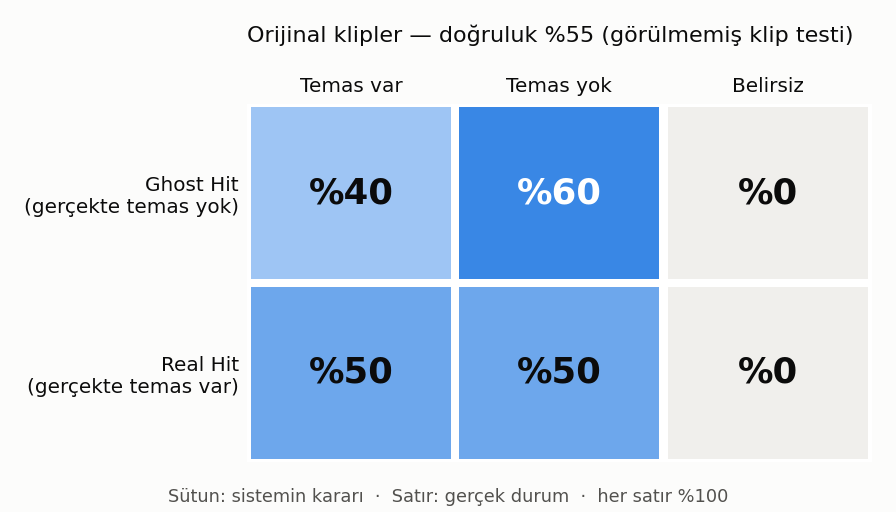

# Sonuç Raporu

*Üretildi: 2026-11-26 00:46 · `python sonuc_raporu.py`*

Bu rapor, sistemin **hiç görmediği kliplerdeki** başarısını özetler. Her klip, tüm çoğaltılmış kopyalarıyla birlikte bir kez dışarıda tutulmuş; karar modeli kalan kliplerle eğitilip dışarıdaki klipte test edilmiştir (birini dışarıda bırakarak doğrulama). Eşikler test verisine göre ayarlanmamıştır.

**Veri hakkında:** Bu alanda kamuya açık, etiketli bir veri seti bulunmuyor ve müsabaka görüntülerinin tamamı paylaşılmadığı için büyük bir veri seti oluşturulamadı. Çalışma az sayıda etiketli klip üzerinde yapıldı; klipler görüntü işleme teknikleriyle çoğaltıldı. Bu yüzden aşağıdaki oranların belirsizlik payı büyüktür.

---

## 1. Özet

| | Sonuç |
|---|---|
| **Doğruluk (orijinal klipler)** | **%55** |
| %95 güven aralığı | %34 – %74 |
| Şans düzeyinde bir sistemin bu kadar veya daha iyi sonuç alma olasılığı | %41 |
| Doğruluk (çoğaltılmış videolar dahil) | %52 |
| Ghost Hit yakalama oranı | %60 |
| Gerçek vuruşu doğru onaylama oranı | %50 |

**Yorum:** %55'lik doğruluk şans düzeyinden istatistiksel olarak ayırt edilemiyor (yazı-tura atan bir sistem de %41 olasılıkla bu sonucu alır). Mevcut ölçümler, eldeki az veriyle Real Hit ile Ghost Hit'i güvenilir biçimde ayıramıyor. Sistem bu yüzden her kararı kalibre edilmiş, çoğunlukla **düşük** bir güvenle verir ve nihai kararı hakeme bırakır.

---

## 2. Karmaşıklık matrisi

Veri setindeki tüm klipler sensörün puan verdiği anlardır. Bu yüzden "temas yok" kararı **Ghost Hit (puan hatalı)**, "temas var" kararı **puan geçerli** anlamına gelir. Her satır, o gerçek durumdaki kliplerin kararlara yüzde dağılımıdır.

| Gerçek durum ↓ / Sistem kararı → | Temas var | Temas yok | Belirsiz |
|---|---|---|---|
| **Ghost Hit** (temas yok) | %40 | %60 | %0 |
| **Real Hit** (temas var) | %50 | %50 | %0 |

- **Yakalanan Ghost Hit:** %60 — sistem hatalı puanı doğru tespit etti.
- **Kaçırılan Ghost Hit:** %40 — hatalı puan geçerli sayıldı.
- **Haksız iptal önerisi:** gerçek vuruşların %50'i için "puan hatalı" denildi. Sahada en maliyetli hata budur; bu yüzden sistemin kararı tek başına puan iptali için kullanılmamalıdır.
- **Doğru onay:** gerçek vuruşların %50'i onaylandı.

---

## 3. Görüntü koşullarına dayanıklılık

| Koşul | Doğruluk |
|---|---|
| Orijinal | %55 |
| Aynalama | %55 |
| Parlak | %45 |
| Karanlık | %55 |
| Gürültülü | %55 |
| Bulanık | %50 |

Kliplerin %55'inde sistem tüm kopyalarda aynı doğrulukta karar verdi; diğerlerinde karar kopyadan kopyaya değişti. Her koşuldaki toplam doğruluk ise benzer: görüntü koşulları başarıyı belirli bir yöne kaydırmıyor, hatalar görüntü kalitesinden çok ölçümlerin kendisinden geliyor.

---

## 4. Ölçümlerin ayırt ediciliği

AUC: rastgele seçilen bir Real Hit klibinin, rastgele bir Ghost Hit klibinden daha yüksek değer alma olasılığı (%50 = şans, %100 = kusursuz ayrım). Ayak-baş mesafesinde küçük değer temas lehinedir, bu yüzden %50'nin altı beklenen yöndür.

| Ölçüm | Ghost Hit ortanca | Real Hit ortanca | AUC |
|---|---|---|---|
| baş dönüşü | 0.91 | 1.07 | %69 |
| burun savrulması | 168.67 | 265.35 | %67 |
| ayak-baş mesafesi | 11.08 | 10.10 | %38 |

Baş dönüşü ve burun savrulması bir eğilim gösteriyor; ancak bu eğilim, klip dışarıda tutulduğunda doğru tahmine dönüşecek kadar güçlü değil.

---

## 5. Güven kalibrasyonu

Arayüzde gösterilen güven, modelin kendi olasılığı değil, benzer olasılıktaki kararların bu dürüst testte **gerçekten doğru çıkma oranıdır**.

| Model olasılığı (karar sınırından uzaklık) | Gerçek doğruluk |
|---|---|
| %50 – %60 | %53 |
| %60 – %75 | %56 |
| %75 – %100 | %53 |

Model kendinden daha emin olduğunda bile gerçek doğruluk belirgin biçimde artmıyor; bu yüzden sistem güveni abartmıyor, çoğu kararı "düşük güven" olarak işaretliyor.

---

## 6. Sistem nerede yanılıyor?

Hataların ortak nedenleri (geliştirme sırasında yapılan testlerle; ayrıntılar [YOL_HARITASI.md](YOL_HARITASI.md)):

1. **Temas anında iskelet noktaları en güvenilmez halinde.** Sporcular temas anında üst üste biniyor; poz modeli yüksek tekmede kafaya uzanan bacağı çoğu zaman yakalayamıyor. Daha büyük poz modeli de bunu çözmedi.
2. **İki boyutlu görüntüde "başın hemen yanından geçen" tekme ile "başa değen" tekme aynı görünüyor.** Ghost Hit kliplerinde de tekme başa çok yakın geçiyor; ayak-baş mesafesi bu yüzden ayırt edici değil.
3. **Başın tepkisi tek başına yetmiyor.** Ghost Hit'te de sporcular refleksle başını çeviriyor, geri çekiliyor ya da düşüyor. Darbe karesi hakem tarafından işaretlense bile ayırt edicilik artmadı.
4. **Veri az.** Kamuya açık bir veri seti olmadığı ve müsabaka görüntülerinin tamamı paylaşılmadığı için küçük bir veriyle çalışıldı; küçük bir gerçek etkinin bile ölçülmesi güç.

---

## 7. Doğruluğun geliştirme boyunca değişimi

Geliştirme sırasında ölçülen %45–%70 arasındaki değerler, kararın eşikleri veya modeli aynı klipler üzerinde ayarlandığı için **iyimserdi**. Dürüst teste (birini dışarıda bırakarak) geçildiğinde doğruluk %55 çıktı. Bu fark, küçük veride "eğitildiği veride test etme" hatasının ne kadar yanıltıcı olabileceğini gösteriyor.

---

## 8. Sonuç ve sonraki adımlar

- Sistem; video analizi, sporcu takibi, baş tepkisi ölçümü, kalibre güvenli karar, hakem girdileri ve PDF raporu ile **uçtan uca çalışan bir karar destek altyapısı** olarak tamamlandı.
- Eldeki az veriyle, görüntüden çıkarılan ölçümler gerçek temas ile hayalet darbeyi **güvenilir biçimde ayıramıyor**. Bu, dürüst ölçümle ortaya konmuş bir bulgudur.
- **En önemli sonraki adım veri:** Daha fazla etiketli müsabaka görüntüsüne erişim sağlanırsa `python egit.py` ve `python sonuc_raporu.py` ile model ve bu rapor kod değişmeden yenilenebilir.
- Uzun vadede: birden fazla kamera açısı (üç boyutlu konum), temas anı için daha yüksek kare hızı ve dövüş sporlarına özel eğitilmiş poz modeli.
